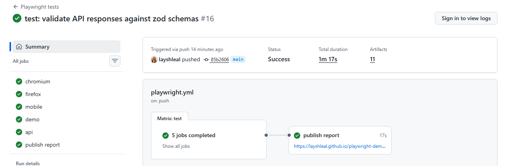
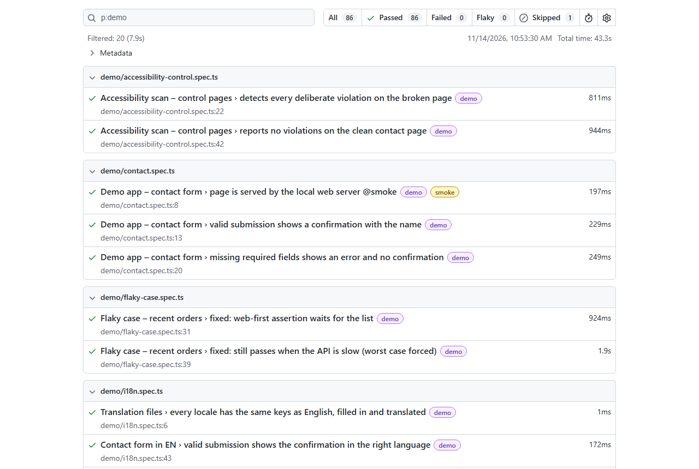

# Playwright Demo – a test automation case study

[](https://github.com/layshleal/playwright-demo/actions/workflows/playwright.yml)
[](https://layshleal.github.io/playwright-demo/)
[](LICENSE)
[](https://playwright.dev)
[](tsconfig.json)

**[View the latest test report](https://layshleal.github.io/playwright-demo/)** – every test, every browser, published from CI on each push to `main`.

A production-style test suite built with **Playwright + TypeScript**, written as the answer to one question: *how do you build UI and API tests a team can actually trust?*

## The problem

Test suites usually fail teams in the same few ways:

- **Flaky tests** – red builds that turn green on re-run, until nobody reads red builds anymore.
- **Gaps nobody checks** – a feature works in Chrome but not on an iPhone, the Italian translation is missing a string, a button has no accessible name.
- **Silent contract changes** – an API starts returning a price as a string and the UI tests still pass.
- **Green that proves nothing** – a scan or assertion that could never fail in the first place.

## The approach

| Problem | What this project does | Details |
|---|---|---|
| Flaky tests | Web-first assertions only, no fixed waits, enforced by ESLint with Playwright rules in CI; retries surface flakes in the report, and a nightly run **fails** on any flaky test. A worked case with real numbers. | [Flaky case](docs/flaky-case.md) |
| Cross-browser gaps | The same suite on Chromium, Firefox and mobile WebKit (iPhone 15 Pro), in parallel CI jobs. | [Structure](#project-structure) |
| Multilingual products | One contact flow in English, Italian and Portuguese; translation files checked for missing, empty or untranslated text; layout checked for cut-off text. | [Multilingual](#multilingual-testing-en--it--pt) |
| Accessibility | axe-core WCAG 2.1 AA scans, a control page with deliberate violations proving the scan catches them, and keyboard tests (Tab order, visible focus). | [Accessibility](#accessibility) |
| Visual regressions | Screenshot comparison with baselines generated on the CI runner image, with a tolerance tight enough to catch a recoloured button. | [Visual](#visual-regression) |
| API contract drift | Every API response validated against a strict zod schema before checking values. | [API contracts](#api-contract-testing) |
| Unreliable backends | Slow, failing, offline and empty API responses forced with `page.route()`, deterministic and without timers. | [Network mocking](#network-mocking) |
| Green that proves nothing | New tests are broken on purpose and seen failing before they are trusted; control tests for the axe scan, the API schemas and the translation checks. | – |

## The result

| | |
|---|---|
| **Tests** | 96 across 5 projects (95 run in CI; 1 deliberately flaky example is opt-in), plus lint and type checks |
| **Browsers** | 3 engines: Chromium, Firefox, WebKit (mobile) |
| **Languages** | 3: English, Italian, Portuguese |
| **CI time** | ~1.5 min per push (77–106 s in recent runs): 5 test jobs in parallel, then the merged HTML report is published |
| **Stability** | 12 consecutive green runs on `main`, including the nightly run that fails on flaky tests |
| **Flaky case** | 5 failures in 50 runs → 0 in 50 after the fix |
| **Accessibility** | 5 page states scanned against WCAG 2.1 AA; 3 of 3 deliberate violations detected on the control page |

<p align="center">
  <br>
  <em>One push: five test jobs in parallel, then the merged report goes to GitHub Pages.</em>
</p>

<p align="center">
  <br>
  <em>The published report, filtered to the demo app project.</em>
</p>

## What is covered

| Layer | Target | What is covered |
|-------|--------|-----------------|
| UI    | [saucedemo.com](https://www.saucedemo.com) | Login (happy path, locked user, validation), product sorting, cart, end-to-end checkout, price math |
| UI    | Local demo app (`demo-app/`) | Contact form in English, Italian and Portuguese, accessibility control pages |
| API   | [Restful Booker](https://restful-booker.herokuapp.com/apidoc/index.html) | Auth, full CRUD lifecycle, authorization errors, query filters, response contracts (schema validation) |

## Highlights

- **Page Object Model** – one class per page, tests read like user stories.
- **Custom fixtures** – page objects and a `loggedIn` state are injected into tests, no setup duplication.
- **Stable locators** – `getByTestId` / `getByRole` only, no CSS or XPath chains.
- **Data-driven tests** – login validation runs from a table of cases.
- **Cross-browser & mobile** – Chromium, Firefox and WebKit (iPhone 15 Pro emulation).
- **Local demo app** – a static site started by Playwright's `webServer` (Node built-ins only, no extra dependencies), for scenarios a third-party site cannot provide.
- **API tests in the same framework** – using Playwright's `request` fixture, with every response validated against a [zod](https://zod.dev) schema through a custom `toMatchSchema` matcher.
- **Tags** – `@smoke` subset for quick feedback.
- **CI-ready** – GitHub Actions matrix per project, nightly schedule, retries + traces on failure, HTML and JUnit reports uploaded as artifacts, merged HTML report published to GitHub Pages.

## Project structure

```
├── .github/workflows/playwright.yml   # CI: matrix per browser + demo + API, nightly run
├── demo-app/                          # local static site + tiny Node server (webServer)
├── fixtures/test.ts                   # custom fixtures (page objects, logged-in state)
├── helpers/accessibility.ts          # shared axe-core scan (WCAG 2.1 A/AA)
├── pages/                             # Page Object Model
│   ├── LoginPage.ts
│   ├── InventoryPage.ts
│   ├── CartPage.ts
│   ├── CheckoutPage.ts
│   ├── ContactPage.ts                 # demo app
│   ├── OrdersPage.ts / OrderHistoryPage.ts  # demo app (flaky case, network mocking)
├── schemas/booking.ts                 # API response contracts (zod)
├── test-data/                         # test users, translations
├── tests/
│   ├── ui/                            # login, inventory, checkout, accessibility
│   ├── demo/                          # tests against the local demo app
│   └── api/                           # booking API + schema control tests
└── playwright.config.ts               # projects: chromium, firefox, mobile, demo, api
```

## Running locally

```bash
npm install
npx playwright install        # browsers

npm test                      # everything
npm run test:smoke            # @smoke tests only
npm run test:api              # API only
npm run test:ui               # UI on all browsers
npm run test:headed           # watch it run in Chromium
npm run report                # open the HTML report
```

Debug a single test with the UI mode:

```bash
npx playwright test --ui
```

## Accessibility

`tests/ui/accessibility.spec.ts` scans the key pages with [axe-core](https://github.com/dequelabs/axe-core) against WCAG 2.1 A/AA rules. Serious and critical violations fail the test; the full axe result is attached to the HTML report.

**The scan is tested too.** A green accessibility scan only means something if it can fail. `tests/demo/accessibility-control.spec.ts` runs axe on a demo page with three deliberate violations (image without `alt`, button without a name, low-contrast text) and asserts that exactly those three are reported, each on the right element. It also checks that the clean contact page reports none.

Automated scanning only catches part of the accessibility issues (roughly 30–40% of WCAG problems), so **keyboard use is tested separately**: `tests/demo/keyboard.spec.ts` checks that Tab reaches every control in visual order, that every Tab stop shows a visible focus indicator (WCAG 2.4.7), that the form can be filled and sent with the keyboard only, and that the error is exposed as an `alert` for screen readers. Breaking the page on purpose proves each check: `outline: none` on links and buttons is reported element by element, and a field removed from the Tab order fails the order test.

What still needs a person: the **screen reader** experience (what is announced, and whether it makes sense) and keyboard behaviour in complex widgets.

## Multilingual testing (EN / IT / PT)

The demo app loads its texts from `demo-app/i18n/<lang>.json`, and the tests import the same files. `tests/demo/i18n.spec.ts` runs the same contact flow in each language and checks:

- **Translation files** – every locale has the same keys as English, no empty values, no text left in English (with a documented allowlist, e.g. Italian "Email"), and placeholders like `{name}` kept.
- **Behaviour per language** – confirmation and validation messages, page title and `<html lang>` (used by screen readers).
- **Layout** – no translated text cut off or overflowing its element, a common bug when Italian or Portuguese strings are longer than English.

Because app and tests share the translation files, these tests catch missing, untranslated or broken texts, not a *wrong* translation. That still needs a native-speaker review.

## Visual regression

`tests/demo/visual.spec.ts` compares three screens of the demo app (English form, Italian validation error, Portuguese confirmation) against baseline images with `toHaveScreenshot`.

- **Baselines are generated in CI, not on a laptop.** Fonts and anti-aliasing differ between Windows, macOS and Linux, so a baseline made locally would fail in CI on pixel noise. The manual workflow **Update visual baselines** (`.github/workflows/update-snapshots.yml`) renders them on the same Ubuntu runner image the tests use (pinned to `ubuntu-26.04`, not `ubuntu-latest`, so a silent runner upgrade cannot invalidate the baselines) and uploads them as an artifact. They are reviewed by eye, then committed.
- **On non-Linux machines the visual tests are skipped** with a clear reason, instead of producing false failures.
- **Tolerance:** at most 100 pixels may differ (anti-aliasing), and animations are disabled. An absolute count on purpose: a 1% ratio was tried first and let a whole button change colour pass (the button is only ~0.5% of the page). A real change, like a different button colour, fails the test and the HTML report shows expected, actual and diff side by side.

To refresh baselines after an intended UI change:

```bash
gh workflow run update-snapshots.yml --ref <your-branch>
gh run download <run-id> -n visual-baselines -D tests/
```

## API contract testing

Checking a few values (`toMatchObject`) misses a whole class of bugs: a price that becomes a string, a date in a new format, a field that disappears or appears. `schemas/booking.ts` describes each Restful Booker response with [zod](https://zod.dev), and every API test validates the body before checking values:

```ts
const { bookingid, booking } = await bodyOf(created, CreateBookingResponseSchema); // validated + typed
expect(booking).toEqual(newBooking);
```

- **Strict objects** – an unexpected extra field fails the test, so contract changes are noticed, not silently accepted.
- **Readable failures** – the custom `toMatchSchema` matcher prints the exact path, e.g. `expected number, received string → at booking.totalprice`.
- **One source of truth** – TypeScript types come from the schemas (`z.infer`), so test data and assertions cannot drift apart.
- **The schema is tested too** – `tests/api/booking-schema.spec.ts` feeds it broken payloads (missing field, price as a string, negative price, non-ISO date, extra field) and checks that each one is rejected.

## Network mocking

`tests/demo/network-mocking.spec.ts` drives the demo app's order history page (`demo-app/order-history.html`, which calls `GET api/orders.json`) through every state with `page.route()`, instead of hoping the backend happens to be slow, broken or empty during a run:

- **Slow API** – the mocked response is *held* until the test has checked the loading state, then released. Deterministic, with no timers.
- **Server error (500) and retry** – the first call fails, "Try again" succeeds, and the test checks exactly two requests were made.
- **Network failure** – the request is aborted as if the connection dropped.
- **Empty list** – the empty-state message is shown.

**A lesson found while writing them:** status messages that are always in the HTML (just `hidden`) pass `toHaveText` even when the user never sees them. Breaking the demo app on purpose so the contact-form error never appeared left four existing tests green. Every message check now asserts `toBeVisible()` first, and the same break turns them red.

## Flaky tests: a worked case

[`docs/flaky-case.md`](docs/flaky-case.md) walks through a deliberately flaky test on the demo app, from symptom to fix, with real numbers. The flaky version failed **5 of 50** runs, retries hid 6 failures and still let 1 through, and the fixed version passed **50 of 50**. It covers measuring with `--repeat-each`, why the common `on-first-retry` trace shows the *passing* retry (this repo now keeps the trace of the first failed attempt instead), the root cause (a one-off `count()` instead of a web-first assertion), and the "fixes" to avoid (`waitForTimeout`, more retries).

## Design decisions

- **Why fixtures instead of `beforeEach` everywhere?** Fixtures make dependencies explicit and lazy: a test that asks for `loggedIn` gets a logged-in session, one that doesn't pays nothing.
- **Why not reuse the login state?** It was tried and measured: one UI login per worker with the session cookies reused, against the login form in every test, over 3 CI runs each. Test time did not improve (Chromium 7.8 s → 9.0 s, Firefox 15.2 s → 14.1 s, mobile 14.3 s → 18.4 s: noise), because saucedemo logs in client-side with no server round-trip. The change was reverted: extra code for no gain. On an app whose login hits a server or needs 2FA, the same pattern does pay off.
- **Why test the price math?** Checking that `total = item total + tax` catches real business bugs, not just "the page loaded".
- **Why retries only in CI?** Locally a failure should be visible immediately; in CI retries with a trace help separate flaky tests from real regressions.

## Author

**Helena Leal** – QA Engineer · Playwright, API testing, CI
[LinkedIn](https://www.linkedin.com/in/lays-helena-leal/)
